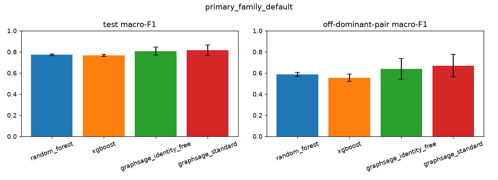
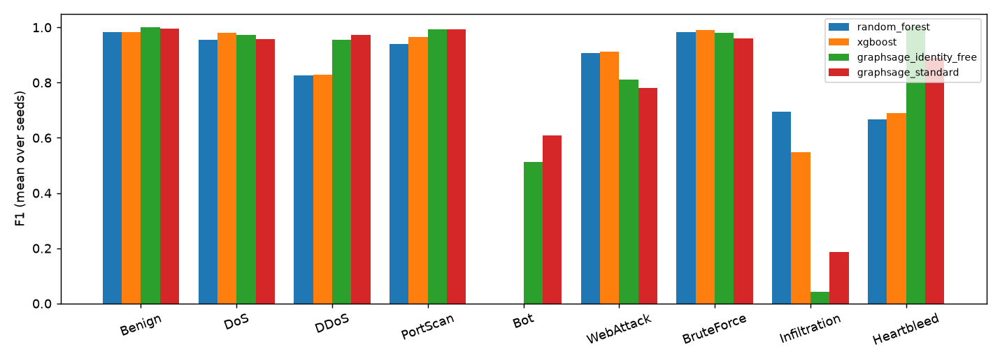
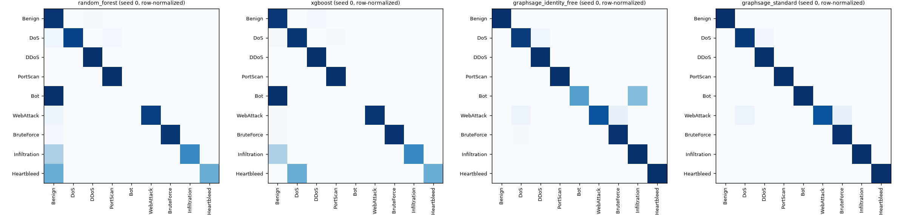
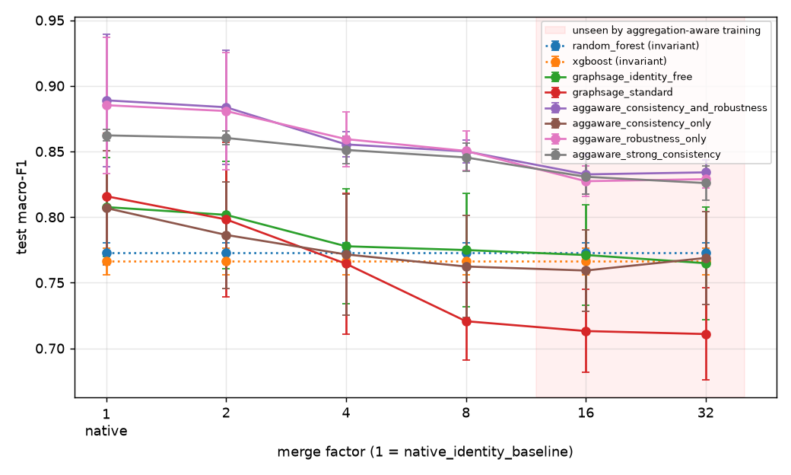
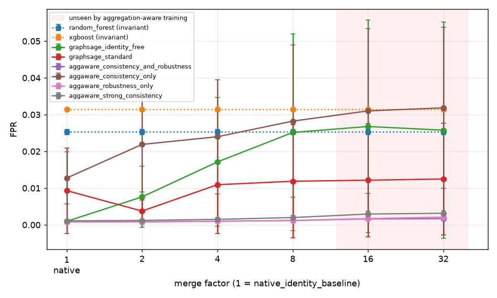
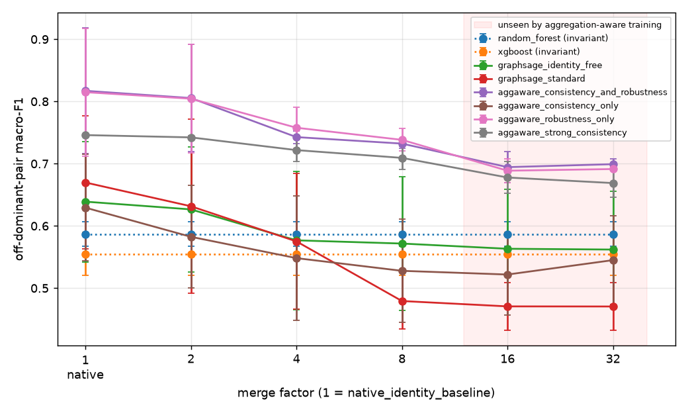

# GraphSentinel results

Generated by `python -m src.evaluation.report` from `experiments/results/**`. All numbers are test-set results of
real runs on CICIDS2017 (processed v1, contract v1.1); mean ± std over seeds unless a single seed is noted.
Primary-split and day-holdout results are separate experiments and are never pooled.

## 1. Primary split, attack family, default features (no Destination Port)

| model | seeds | macro-F1 | FPR | macro PR-AUC | off-pair macro-F1 | dedup-test macro-F1 (s0) | FPR on dominant pair (s0) | ms/1k flows |
|---|---|---|---|---|---|---|---|---|
| random_forest | 3 | 0.773 ± 0.008 | 2.53% ± 0.07% | 0.837 ± 0.006 | 0.587 ± 0.019 | 0.683 | 0.0% | 3.4 |
| xgboost | 3 | 0.766 ± 0.010 | 3.15% ± 0.02% | 0.837 ± 0.012 | 0.555 ± 0.035 | 0.694 | 9.3% | 1.7 |
| graphsage_identity_free | 3 | 0.808 ± 0.038 | 0.10% ± 0.02% | 0.918 ± 0.036 | 0.639 ± 0.097 | 0.788 | 100.0% | 2.5 |
| graphsage_standard | 3 | 0.816 ± 0.048 | 0.93% ± 1.16% | 0.885 ± 0.071 | 0.670 ± 0.107 | 0.809 | 100.0% | 2.3 |

### Per-class recall

| class | test support | random_forest recall | xgboost recall | graphsage_identity_free recall | graphsage_standard recall |
|---|---|---|---|---|---|
| Benign | 340,920 | 0.975 ± 0.001 | 0.969 ± 0.000 | 0.999 ± 0.000 | 0.991 ± 0.012 |
| DoS | 37,132 | 0.923 ± 0.003 | 0.969 ± 0.004 | 0.951 ± 0.003 | 0.971 ± 0.007 |
| DDoS | 19,205 | 0.997 ± 0.000 | 0.998 ± 0.000 | 0.997 ± 0.000 | 0.997 ± 0.000 |
| PortScan | 9,026 | 0.997 ± 0.000 | 0.997 ± 0.000 | 0.992 ± 0.000 | 0.991 ± 0.001 |
| Bot | 295 | 0.000 ± 0.000 | 0.000 ± 0.000 | 0.523 ± 0.410 | 0.667 ± 0.471 |
| WebAttack | 329 | 0.942 ± 0.000 | 0.978 ± 0.003 | 0.876 ± 0.014 | 0.855 ± 0.016 |
| BruteForce | 2,076 | 0.976 ± 0.000 | 0.982 ± 0.001 | 0.984 ± 0.001 | 0.987 ± 0.003 |
| Infiltration | 6 | 0.667 ± 0.000 | 0.667 ± 0.000 | 1.000 ± 0.000 | 0.889 ± 0.157 |
| Heartbleed | 2 | 0.500 ± 0.000 | 0.667 ± 0.236 | 1.000 ± 0.000 | 0.833 ± 0.236 |

## 2. GraphSAGE context modes (contract §6.3, native identities)

| model | mode | macro-F1 | FPR | off-pair macro-F1 |
|---|---|---|---|---|
| graphsage_identity_free | cumulative | 0.808 ± 0.038 | 0.10% ± 0.02% | 0.639 ± 0.097 |
| graphsage_identity_free | period_only | 0.142 ± 0.056 | 0.01% ± 0.00% | 0.305 ± 0.079 |
| graphsage_identity_free | prior_only | 0.783 ± 0.029 | 0.33% ± 0.16% | 0.581 ± 0.064 |
| graphsage_standard | cumulative | 0.816 ± 0.048 | 0.93% ± 1.16% | 0.670 ± 0.107 |
| graphsage_standard | period_only | 0.648 ± 0.006 | 1.59% ± 2.19% | 0.465 ± 0.035 |
| graphsage_standard | prior_only | 0.797 ± 0.063 | 1.35% ± 1.71% | 0.628 ± 0.139 |

## 3. Robustness across identity aggregation (primary split)

Merge factor 1 = `native_identity_baseline` (already NAT-aggregated). Higher = synthetic aggregation (one seeded
mapping per level). Aggregation-aware models were trained with factors 2/4/8; 16 and 32 are unseen.

| model | ×1 native | ×2 | ×4 | ×8 | ×16 (unseen) | ×32 (unseen) |
|---|---|---|---|---|---|---|
| random_forest (invariant) | 0.773 ± 0.008 | 0.773 ± 0.008 | 0.773 ± 0.008 | 0.773 ± 0.008 | 0.773 ± 0.008 | 0.773 ± 0.008 |
| xgboost (invariant) | 0.766 ± 0.010 | 0.766 ± 0.010 | 0.766 ± 0.010 | 0.766 ± 0.010 | 0.766 ± 0.010 | 0.766 ± 0.010 |
| graphsage_identity_free | 0.808 ± 0.038 | 0.802 ± 0.041 | 0.778 ± 0.044 | 0.775 ± 0.043 | 0.771 ± 0.038 | 0.765 ± 0.043 |
| graphsage_standard | 0.816 ± 0.048 | 0.798 ± 0.059 | 0.764 ± 0.053 | 0.721 ± 0.030 | 0.713 ± 0.032 | 0.711 ± 0.035 |
| aggaware_consistency_and_robustness | 0.889 ± 0.051 | 0.884 ± 0.043 | 0.855 ± 0.009 | 0.850 ± 0.009 | 0.833 ± 0.015 | 0.834 ± 0.009 |
| aggaware_consistency_only | 0.807 ± 0.043 | 0.786 ± 0.041 | 0.772 ± 0.046 | 0.762 ± 0.039 | 0.759 ± 0.031 | 0.769 ± 0.035 |
| aggaware_robustness_only | 0.885 ± 0.052 | 0.881 ± 0.045 | 0.859 ± 0.021 | 0.850 ± 0.015 | 0.827 ± 0.011 | 0.829 ± 0.007 |
| aggaware_strong_consistency | 0.862 ± 0.004 | 0.860 ± 0.005 | 0.851 ± 0.010 | 0.845 ± 0.011 | 0.831 ± 0.013 | 0.826 ± 0.013 |

FPR:

| model | ×1 | ×2 | ×4 | ×8 | ×16 | ×32 |
|---|---|---|---|---|---|---|
| random_forest (invariant) | 2.53% ± 0.07% | 2.53% ± 0.07% | 2.53% ± 0.07% | 2.53% ± 0.07% | 2.53% ± 0.07% | 2.53% ± 0.07% |
| xgboost (invariant) | 3.15% ± 0.02% | 3.15% ± 0.02% | 3.15% ± 0.02% | 3.15% ± 0.02% | 3.15% ± 0.02% | 3.15% ± 0.02% |
| graphsage_identity_free | 0.10% ± 0.02% | 0.76% ± 0.83% | 1.71% ± 1.76% | 2.51% ± 2.68% | 2.68% ± 2.89% | 2.58% ± 2.94% |
| graphsage_standard | 0.93% ± 1.16% | 0.38% ± 0.30% | 1.09% ± 1.32% | 1.19% ± 1.54% | 1.21% ± 1.54% | 1.25% ± 1.52% |
| aggaware_consistency_and_robustness | 0.08% ± 0.04% | 0.08% ± 0.04% | 0.10% ± 0.03% | 0.12% ± 0.04% | 0.16% ± 0.05% | 0.17% ± 0.04% |
| aggaware_consistency_only | 1.28% ± 0.71% | 2.19% ± 1.30% | 2.40% ± 1.55% | 2.82% ± 2.07% | 3.10% ± 2.24% | 3.18% ± 2.19% |
| aggaware_robustness_only | 0.08% ± 0.04% | 0.08% ± 0.04% | 0.10% ± 0.04% | 0.12% ± 0.03% | 0.17% ± 0.03% | 0.21% ± 0.02% |
| aggaware_strong_consistency | 0.11% ± 0.01% | 0.12% ± 0.01% | 0.15% ± 0.02% | 0.20% ± 0.06% | 0.29% ± 0.08% | 0.32% ± 0.07% |

Off-dominant-pair macro-F1:

| model | ×1 | ×2 | ×4 | ×8 | ×16 | ×32 |
|---|---|---|---|---|---|---|
| random_forest (invariant) | 0.587 ± 0.019 | 0.587 ± 0.019 | 0.587 ± 0.019 | 0.587 ± 0.019 | 0.587 ± 0.019 | 0.587 ± 0.019 |
| xgboost (invariant) | 0.555 ± 0.035 | 0.555 ± 0.035 | 0.555 ± 0.035 | 0.555 ± 0.035 | 0.555 ± 0.035 | 0.555 ± 0.035 |
| graphsage_identity_free | 0.639 ± 0.097 | 0.627 ± 0.100 | 0.577 ± 0.111 | 0.572 ± 0.107 | 0.563 ± 0.096 | 0.562 ± 0.093 |
| graphsage_standard | 0.670 ± 0.107 | 0.632 ± 0.140 | 0.575 ± 0.109 | 0.479 ± 0.045 | 0.471 ± 0.038 | 0.471 ± 0.038 |
| aggaware_consistency_and_robustness | 0.817 ± 0.101 | 0.805 ± 0.086 | 0.743 ± 0.010 | 0.732 ± 0.008 | 0.694 ± 0.025 | 0.699 ± 0.009 |
| aggaware_consistency_only | 0.629 ± 0.085 | 0.583 ± 0.082 | 0.548 ± 0.100 | 0.528 ± 0.083 | 0.522 ± 0.065 | 0.545 ± 0.071 |
| aggaware_robustness_only | 0.815 ± 0.102 | 0.804 ± 0.087 | 0.758 ± 0.033 | 0.738 ± 0.018 | 0.689 ± 0.020 | 0.691 ± 0.002 |
| aggaware_strong_consistency | 0.746 ± 0.000 | 0.742 ± 0.003 | 0.722 ± 0.018 | 0.709 ± 0.019 | 0.678 ± 0.025 | 0.669 ± 0.022 |

## 4. E-PS1: PortScan with vs without Destination Port

| features | model | PortScan recall | PortScan F1 | PortScan precision (s0) | macro-F1 | FPR |
|---|---|---|---|---|---|---|
| default | random_forest | 0.997 ± 0.000 | 0.939 ± 0.001 | 0.888 | 0.773 ± 0.008 | 2.53% ± 0.07% |
| default | xgboost | 0.997 ± 0.000 | 0.966 ± 0.008 | 0.949 | 0.766 ± 0.010 | 3.15% ± 0.02% |
| default | graphsage_identity_free | 0.992 ± 0.000 | 0.993 ± 0.003 | 0.997 | 0.808 ± 0.038 | 0.10% ± 0.02% |
| default | graphsage_standard | 0.991 ± 0.001 | 0.993 ± 0.001 | 0.997 | 0.816 ± 0.048 | 0.93% ± 1.16% |
| dstport | random_forest | 0.996 ± 0.000 | 0.931 ± 0.002 | 0.872 | 0.776 ± 0.007 | 2.33% ± 0.05% |
| dstport | xgboost | 0.997 ± 0.000 | 0.952 ± 0.001 | 0.911 | 0.813 ± 0.044 | 2.87% ± 0.46% |
| dstport | graphsage_identity_free | 0.992 ± 0.000 | 0.995 ± 0.000 | 0.999 | 0.818 ± 0.043 | 0.90% ± 1.08% |
| dstport | graphsage_standard | 0.991 ± 0.002 | 0.994 ± 0.001 | 0.999 | 0.818 ± 0.034 | 0.47% ± 0.51% |

| features | collision groups | rows in groups | PortScan rows identical to a BENIGN flow | test PortScan rows with a train twin of another label |
|---|---|---|---|---|
| default | 271 | 82,868 | 76,322 / 158,930 | 8,599 |
| dstport | 697 | 7,018 | 1,053 / 158,930 | 120 |

Destination Port is a legitimate feature but may encode dataset-specific attack signatures; a higher with-port
score is not evidence of better generalization by itself.

## 5. Day-holdout generalization (binary; train Mon–Wed, test Thu–Fri)

### dayholdout_binary_default

| model | seeds | macro-F1 | FPR | macro PR-AUC | off-pair macro-F1 | dedup-test macro-F1 (s0) | FPR on dominant pair (s0) | ms/1k flows |
|---|---|---|---|---|---|---|---|---|
| random_forest | 3 | 0.664 ± 0.000 | 0.12% ± 0.00% | 0.855 ± 0.015 | 0.499 ± 0.000 | 0.658 | 2.3% | 1.6 |
| xgboost | 3 | 0.452 ± 0.014 | 0.04% ± 0.00% | 0.829 ± 0.015 | 0.499 ± 0.000 | 0.427 | 4.5% | 1.0 |
| graphsage_identity_free | 3 | 0.886 ± 0.093 | 0.03% ± 0.01% | 0.996 ± 0.001 | 0.499 ± 0.000 | 0.887 | 86.5% | 1.4 |
| graphsage_standard | 3 | 0.997 ± 0.000 | 0.07% ± 0.05% | 0.996 ± 0.001 | 0.499 ± 0.000 | 0.997 | 100.0% | 1.4 |

| model | attack recall (mean) | benign recall (mean) |
|---|---|---|
| random_forest | 0.280 ± 0.000 | 0.999 ± 0.000 |
| xgboost | 0.023 ± 0.014 | 1.000 ± 0.000 |
| graphsage_identity_free | 0.717 ± 0.221 | 1.000 ± 0.000 |
| graphsage_standard | 0.993 ± 0.000 | 0.999 ± 0.000 |

### dayholdout_binary_dstport

| model | seeds | macro-F1 | FPR | macro PR-AUC | off-pair macro-F1 | dedup-test macro-F1 (s0) | FPR on dominant pair (s0) | ms/1k flows |
|---|---|---|---|---|---|---|---|---|
| random_forest | 3 | 0.665 ± 0.000 | 0.06% ± 0.00% | 0.852 ± 0.050 | 0.499 ± 0.000 | 0.659 | 4.5% | 1.6 |
| xgboost | 3 | 0.664 ± 0.002 | 0.03% ± 0.00% | 0.796 ± 0.037 | 0.499 ± 0.000 | 0.662 | 5.3% | 0.9 |

| model | attack recall (mean) | benign recall (mean) |
|---|---|---|
| random_forest | 0.280 ± 0.000 | 0.999 ± 0.000 |
| xgboost | 0.279 ± 0.003 | 1.000 ± 0.000 |

## 6. Dominant-pair ablation (all 172.16.0.1 ↔ 192.168.10.50 flows removed; contract §6.5 view 4)

| model | seeds | macro-F1 | FPR | macro PR-AUC | off-pair macro-F1 | dedup-test macro-F1 (s0) | FPR on dominant pair (s0) | ms/1k flows |
|---|---|---|---|---|---|---|---|---|
| random_forest | 1 | 0.617 | 0.03% | 0.684 | 0.617 | 0.617 | — | 1.9 |
| xgboost | 1 | 0.617 | 0.03% | 0.647 | 0.617 | 0.616 | — | 1.2 |
| graphsage_identity_free | 1 | 0.250 | 0.00% | 0.251 | 0.250 | 0.250 | — | 2.2 |
| graphsage_standard | 1 | 0.515 | 0.17% | 0.614 | 0.515 | 0.515 | — | 2.3 |

| class | test support | random_forest recall | xgboost recall | graphsage_identity_free recall | graphsage_standard recall |
|---|---|---|---|---|---|
| Benign | 318156 | 1.000 | 1.000 | 1.000 | 0.998 |
| DoS | 0 | not evaluable | not evaluable | not evaluable | not evaluable |
| DDoS | 0 | not evaluable | not evaluable | not evaluable | not evaluable |
| PortScan | 0 | not evaluable | not evaluable | not evaluable | not evaluable |
| Bot | 295 | 0.000 | 0.000 | 0.000 | 0.000 |
| WebAttack | 0 | not evaluable | not evaluable | not evaluable | not evaluable |
| BruteForce | 0 | not evaluable | not evaluable | not evaluable | not evaluable |
| Infiltration | 6 | 0.667 | 0.667 | 0.000 | 0.667 |
| Heartbleed | 2 | 0.500 | 0.500 | 0.000 | 0.500 |

## 7. Graph structure under aggregation (all flows)

| level | buckets | unique pairs | avg degree | density | self-loop flows | mean nbr Jaccard | dominant bucket pair attack fraction |
|---|---|---|---|---|---|---|---|
| native_identity_baseline | 19,129 | 113,769 | 11.9 | 3.11e-04 | 0 | 1.000 | 99.98% |
| merge_factor_2 | 9,565 | 98,134 | 20.5 | 1.07e-03 | 38 | 0.577 | 99.98% |
| merge_factor_4 | 4,783 | 75,126 | 31.4 | 3.28e-03 | 100 | 0.381 | 99.98% |
| merge_factor_8 | 2,392 | 48,207 | 40.3 | 8.43e-03 | 246 | 0.308 | 99.98% |
| merge_factor_16 | 1,196 | 26,304 | 44.0 | 1.84e-02 | 421 | 0.287 | 99.98% |
| merge_factor_32 | 598 | 13,433 | 44.9 | 3.76e-02 | 1,377 | 0.277 | 99.98% |

